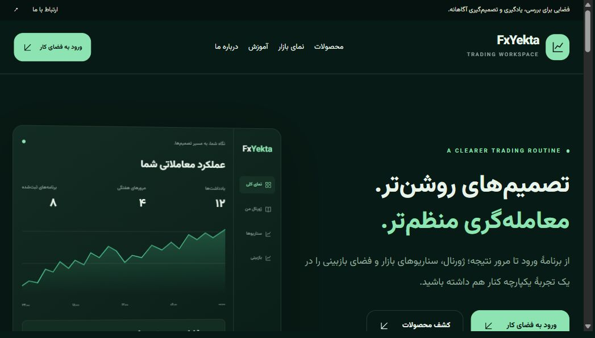
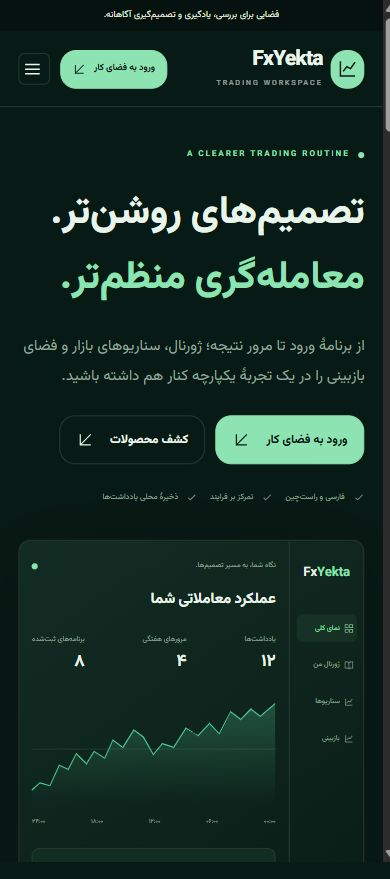

# fxyekta — Independent Frontend

نسخهٔ چندصفحه‌ای و مستقل برای ارائهٔ نمونه‌کار؛ HTML، CSS و JavaScript بدون وابستگی به فریم‌ورک یا سایت اصلی.

## اجرا روی ویندوز

1. ZIP را به‌طور کامل Extract کنید. فایل را از داخل پنجرهٔ ZIP اجرا نکنید.
2. فایل **start.cmd** را دوبار کلیک کنید. فایل strat.cmd نیز به همین راه‌انداز هدایت می‌کند.
3. پنجرهٔ ترمینال را باز نگه دارید. مرورگر پس از آماده‌شدن سرور باز می‌شود.
4. اگر مرورگر باز نشد، نشانی چاپ‌شده را در مرورگر وارد کنید. پورت پیش‌فرض 4175 است؛ در صورت اشغال، پورت بعدی انتخاب می‌شود.

Node.js نسخهٔ ۲۰ یا جدیدتر لازم است. نصب وابستگی لازم نیست. برای اجرای دستی:

```sh
node server.mjs
```

## صفحه‌ها و امکانات

- صفحهٔ اصلی و سه صفحهٔ معرفی ابزار
- نمای بازار با نمودار و سناریوهای داخلی
- آکادمی و سه مقاله
- پنل کاربر، ژورنال محلی و پنل مدیریت با تاریخچهٔ نسخه‌ها
- دربارهٔ ما، تماس، پرسش‌های متداول و حریم خصوصی
- صفحهٔ 404 و ناوبری داخلی
- فرم تماس با اعتبارسنجی و کد پیگیری محلی
- طراحی راست‌چین و واکنش‌گرا، منوی موبایل و دسترسی با صفحه‌کلید

## استقلال نسخه

لینک‌های قابل کلیک صفحات، همگی داخلی هستند. فونت، عکس‌ها، CSS، JavaScript و نمودارها از همین پروژه بارگذاری می‌شوند. برای مشاهدهٔ صفحات نیازی به WordPress، API یا سایت اصلی نیست. سرور محلی درخواست‌های خارجی و iframeها را با Content Security Policy مسدود می‌کند.

فرم‌ها، ژورنال و تنظیمات فقط در مرورگر ذخیره می‌شوند. هیچ درخواست واقعی به فروش، پرداخت، معامله یا پیام‌رسان ارسال نمی‌شود. داده‌های مالی و پلتفرم‌های مقایسه ساختگی‌اند و در رابط مشخص شده‌اند.

## نقش و سابقهٔ پروژه

صاحب رزومه اجرای کامل پروژهٔ اختصاصی FxYekta را بر عهده داشته است. نسخهٔ فعلی صفحات عمومی را با ساختار جدید بازطراحی می‌کند و از دارایی‌ها و رابط مدیریت سورس ارائه‌شده استفاده می‌کند. آماده‌سازی این نسخه با کمک هوش مصنوعی انجام شده است.

## ساختار

- index.html: خانه
- site.css: طراحی و اندازه‌های واکنش‌گرا
- site.js: منو، فیلترها، فرم‌ها و تعاملات عمومی
- server.mjs: سرور محلی، مسیرها و انتخاب پورت آزاد
- assets/: تصاویر و فونت‌های محلی
- پوشه‌های صفحه‌ها: فایل index.html هر مسیر

مسیر دارایی‌ها از ریشه است؛ پروژه را در ریشهٔ یک میزبان استاتیک قرار دهید. برای GitHub Pages با زیرمسیر مخزن، باید مسیر پایه را بازنویسی کنید.

## بررسی

```sh
npm run check
```

گزارش تست در VERIFICATION.md است. حقوق تصاویر و برندها متعلق به صاحبان آن‌هاست؛ مجوز فونت در assets/Vazirmatn-OFL.txt و سوابق دارایی‌ها در ASSET-SOURCES.md حفظ شده است.

## پیش‌نمایش





## GitHub Pages

Settings → Pages → Source: GitHub Actions. Push to main, then run the Publish website to GitHub Pages workflow. The build rewrites internal paths for this repository subdirectory.

Expected URL after a successful deployment: https://arsalanbolt83-1379.github.io/fxyekta-frontend/

Local build: npm run build:pages. _site/ is generated and ignored by Git.
